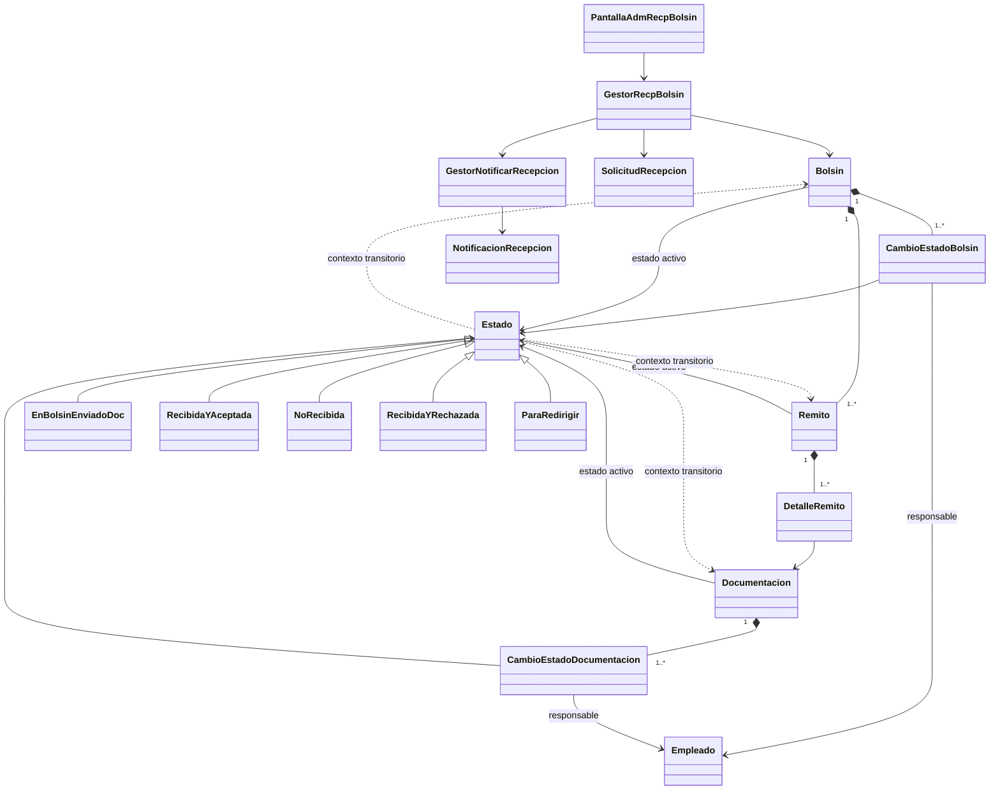
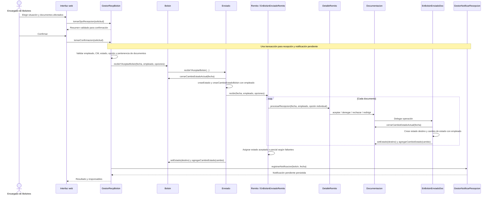

# PPAI 2026 — CU28: Registrar recepción de bolsín

Diseño de Sistemas de Información, UTN FRC. Grupo 8, curso 3K2. Versión 2.0, integrada con V3 de upstream/main. Entrega 2: implementación del rediseño con patrón State sobre Documentación, conforme al alcance del CU28 de la ERS v1.2.

Java 17+, Spring Boot 3.2.5, interfaz web HTML/JavaScript, SQLite y persistencia JPA/Hibernate. Se requiere Maven 3.6+.

## Ejecutar

```bash
mvn spring-boot:run
```

Abrir http://localhost:8080. Se utiliza una única sesión de demostración precargada para el empleado José Aita Tagle de la CMC Córdoba; no se implementa autenticación. La base `bolsines.db` conserva las recepciones entre reinicios. Las bases anteriores se adaptan al arrancar: se recupera el estado activo desde el historial; no hace falta borrar el archivo. El botón **Reiniciar BD Demo** elimina los registros de demostración y vuelve a cargar los datos iniciales.

## Demostrar el CU28 - (Apretar el Reiniciar BD por las dudas)

1. Buscar los bolsines enviados a la CM del empleado. Se puede filtrar por precinto o CM origen; los filtros sin coincidencias muestran el resultado vacío (A1/A2).
2. Seleccionar el bolsín 1042, que contiene dos documentos.
3. Para el flujo principal, elegir **El contenido del bolsín es igual al registrado**, continuar y confirmar. Se aceptan todos los documentos y remitos.
4. Reiniciar la demo para repetir con otra situación. Para faltantes (A3), elegir la opción y marcar solo el documento que no llegó: ese documento queda NoRecibida, el restante se acepta y el remito queda parcial.
5. Para rechazo (A4), marcar solo el documento que no corresponde a la CM. Para redirección (A5), marcar los documentos a distribuir internamente en la CMC.
6. Mostrar los estados finales y el empleado responsable. Volver o cancelar antes de confirmar no registra cambios (A6 y observación 1).

Los contextos guardan una referencia al estado activo; los estados concretos crean los estados destino y los cambios de historial con su responsable. Las referencias inversas se reconstruyen al cargar las entidades. Las bases anteriores se adaptan al iniciar sin borrar sus datos.

El patrón State conserva las referencias inversas y las fábricas de estados de V3. Cada contexto guarda su estado activo y mantiene la trazabilidad en sus cambios de estado; las recepciones nuevas registran el empleado responsable.

La selección se mantiene en cada pestaña. El servidor vuelve a validar la solicitud completa al confirmar y no conserva selecciones globales.

## Notificación al origen: integración pendiente

La recepción invoca `GestorNotificarRecepcion`, que guarda en la misma transacción una notificación con destinatario y situación de cada documento. **El envío por email del CU29 está pendiente de integrar con un servicio de correo.** La interfaz informa “pendiente de envío”; no se envían correos reales.

## Verificar

```bash
mvn test
```

Las pruebas utilizan una base SQLite temporal independiente de `bolsines.db`. Cubren los flujos de recepción, validaciones, responsables, atomicidad, selecciones independientes y persistencia tras reiniciar y migración del esquema anterior.

La adecuación al CU28, la validación de la máquina de estados y los diagramas de diseño se incluyen en este README. Los PDF aportados permanecen sin modificar; estos diagramas sirven de base para actualizar la entrega formal.

## Implementación de la persistencia

### Tecnología y configuración

La persistencia se implementa con Spring Data JPA, Hibernate ORM y el dialecto SQLite (`org.hibernate.community.dialect.SQLiteDialect`). La configuración está en `src/main/resources/application.properties`:

- `spring.datasource.url=jdbc:sqlite:bolsines.db`: usa un archivo SQLite llamado `bolsines.db`, relativo al directorio de trabajo del proceso. Por eso, al ejecutar Maven desde la carpeta del proyecto, el archivo se crea allí y mantiene los datos entre reinicios.
- `spring.datasource.driver-class-name=org.sqlite.JDBC`: selecciona el driver JDBC de SQLite.
- `spring.jpa.hibernate.ddl-auto=update`: Hibernate crea las tablas faltantes y ajusta el esquema al inicio. No recrea toda la base; las adaptaciones de datos puntuales están en `DataSeeder`.
- `spring.jpa.open-in-view=false`: desactiva la sesión JPA abierta durante toda la respuesta HTTP. Las operaciones que requieren cargar y modificar entidades se ejecutan desde servicios transaccionales.

Las entidades usan claves `Long` generadas con `GenerationType.IDENTITY`. Los repositorios extienden `JpaRepository`, por lo que las operaciones habituales de búsqueda y escritura se delegan a Spring Data. Por ejemplo, `BolsinRepository` permite buscar por ID, listar, guardar y eliminar bolsines sin implementar SQL propio.

### Entidades, tablas y relaciones

Cada clase anotada con `@Entity` se mapea a una tabla. Las asociaciones se expresan como referencias JPA y Hibernate mantiene las claves foráneas:

- `Bolsin` tiene relaciones `ManyToOne` con las comisiones médicas de origen y destino, y una relación `OneToMany` con sus `Remito` y `CambioEstadoBolsin`. Las colecciones usan `CascadeType.ALL` y `orphanRemoval=true`: guardar el bolsín propaga sus cambios a esos elementos y quitar un elemento de la colección lo elimina al guardar.
- `Remito` contiene sus `DetalleRemito` en una colección `OneToMany`, relacionada mediante la columna `remito_id`, con cascada y eliminación de huérfanos. Cada detalle tiene una relación obligatoria `ManyToOne` a `Documentacion`, con `CascadeType.ALL`.
- `Documentacion` tiene una colección `OneToMany` de `CambioEstadoDocumentacion`, vinculada por `documentacion_id`, también con cascada y eliminación de huérfanos. Su `TipoDocumentacion` es una relación `ManyToOne` obligatoria.
- Tanto `Bolsin` como `Documentacion` tienen una relación `ManyToOne` al `Estado` activo, con cascada de persistencia y actualización (`PERSIST`, `MERGE`). `Remito` también referencia su estado activo y usa las mismas cascadas, con relación obligatoria.
- Cada cambio de estado apunta al `Estado` que describe esa etapa y, opcionalmente, al `Empleado` responsable. Los cambios de recepción nuevos incluyen empleado; los registros antiguos o los estados iniciales pueden no tenerlo.
- `Empleado` se relaciona uno a uno con `Usuario` y muchos a uno con su `ComisionMedica`. `Sesion` apunta a `Usuario`. Las notificaciones se guardan en `NotificacionRecepcion` con el ID del bolsín, destinatario, asunto, cuerpo, fecha y estado de envío.

`Estado` usa herencia JPA `SINGLE_TABLE`: las instancias concretas de los estados de bolsín, remito y documentación comparten la tabla `estado`, diferenciadas por la columna discriminadora `tipo_estado`. Las referencias desde `Estado` hacia el `Bolsin`, `Remito` o `Documentacion` que lo utiliza son `@Transient` y no generan columnas ni asociaciones persistidas. Los contextos restablecen esas referencias inversas al cargar (`@PostLoad`) y al asignar o usar el estado. Así se conserva la delegación del patrón State sin persistir ciclos de objetos.

### Estado actual y trazabilidad

El proyecto guarda el estado de dos formas complementarias. La columna asociada a `estado` en cada contexto indica directamente el estado actual y se usa para filtrar o ejecutar la próxima transición. Además, cada transición de bolsín y documentación agrega un registro de historial con estado, fecha y hora de inicio, fecha y hora de fin y empleado responsable. Al avanzar, se cierra el registro vigente asignándole fecha de fin y se agrega otro registro con fecha de fin nula. `Remito` conserva su estado activo, pero no tiene una entidad de historial de cambios propia.

`Bolsin` y `Documentacion` declaran `@Version` para control optimista: Hibernate incluye la versión al actualizar y puede rechazar una escritura basada en una versión obsoleta. `Remito` y las demás entidades no declaran ese campo. SQLite serializa las escrituras, por lo que el control optimista ayuda a detectar actualizaciones concurrentes de esos dos agregados, pero no reemplaza una estrategia de alta concurrencia.

### Qué ocurre al confirmar una recepción

La confirmación se implementa en `GestorRecpBolsin.tomarConfirmacion`, anotado `@Transactional`. Dentro de una sola transacción el gestor:

1. Resuelve el empleado de la sesión activa precargada y vuelve a cargar el bolsín con `BolsinRepository.findById`.
2. Verifica que el bolsín corresponda a la comisión del empleado, siga Enviado, que la opción sea válida y que los documentos afectados pertenezcan a ese bolsín.
3. Delega al estado actual del bolsín. Los estados concretos procesan cada detalle y documentación, cierran los cambios vigentes, crean estados e historiales nuevos y actualizan los estados de remito y bolsín.
4. Ejecuta `bolsines.saveAndFlush(bolsin)`. Las cascadas persisten los estados e historiales nuevos relacionados con el agregado antes de continuar.
5. Invoca `GestorNotificarRecepcion.registrarNotificacion`. Este método exige una transacción existente (`Propagation.MANDATORY`) y guarda la notificación con `NotificacionRecepcionRepository.save` dentro de esa misma transacción.

La notificación contiene un resumen de estados por remito y documento y comienza en `PENDIENTE_ENVIO`; no se conecta a SMTP ni envía correo. Si ocurre una excepción antes del commit, Spring revierte tanto la actualización de la recepción como la notificación. Las consultas para mostrar bolsines y previsualizar una opción no guardan cambios. La solicitud de confirmación se vuelve a validar en el servidor, en vez de confiar en los datos de la pantalla.

### Arranque, datos de demostración y compatibilidad

`DataSeeder` implementa `ApplicationRunner` y su método `run` es transaccional. En cada arranque inicializa a cero las versiones nulas y, para bolsines y documentación cuyo campo de estado activo esté nulo, toma el `estado_id` del registro de historial sin fecha de fin. Luego solo carga la demo cuando `BolsinRepository.count()` da cero; si ya existe al menos un bolsín, deja la información existente. No utiliza Flyway o Liquibase: la actualización estructural depende de `ddl-auto=update` y la adaptación de datos está codificada explícitamente en el seeder.

La acción **Reiniciar BD Demo** invoca la recarga de datos iniciales: elimina notificaciones y bolsines, sesiones, empleados, usuarios, comisiones, tipos de documentación y estados, y vuelve a construir los datos de muestra. Esto borra los datos guardados en esa base; para conservar una demo previa, no usar ese botón. Las pruebas configuran una base SQLite temporal aparte y no escriben en el archivo `bolsines.db` de ejecución.

## Adecuación del CU28 a la ERS v1.2 y la Entrega 2

Referencias aportadas: ERS v1.2 (reglas de negocio, página 6; CU28, páginas 11–12), consignas 2026 (Entrega 2, página 4) y diagrama de clases Rediseño v2.1. Este documento registra los cambios que deben trasladarse a los modelos de entrega; no modifica los PDF originales ni reemplaza la presentación formal con carátula.

## Alcance y decisiones

El grupo 8 implementa CU28 y aplica State a Documentación. Se conserva la jerarquía común `Estado` del diagrama, con estados concretos para Bolsín, Remito y Documentación. La integración de V3 (`upstream/main`, commit `da63ebc`) agrega una referencia directa al estado activo y una referencia inversa transitoria desde el estado al contexto. Las entidades delegan las operaciones al estado actual; los estados concretos crean los estados destino y los cambios de estado; el gestor coordina la transacción y valida el contexto de la recepción.

La elección se realiza para el bolsín y se identifican los documentos afectados. Los demás documentos se aceptan. Una recepción registra una de las situaciones enumeradas en el CU28; combinar varias situaciones diferentes en una misma recepción queda fuera de esta interfaz.

| Situación | Documentos afectados | Documentos restantes | Remito |
| --- | --- | --- | --- |
| Contenido completo | Todos recibidos y aceptados | No aplica | Recibido y aceptado |
| Faltantes | No recibidos | Recibidos y aceptados | Parcial si contiene faltantes; aceptado si no los contiene |
| No corresponden al destino | Recibidos y rechazados | Recibidos y aceptados | Parcial si contiene rechazados y aceptados; rechazado si **todos** sus documentos fueron rechazados |
| Redirección en CMC | Para redirigir | Recibidos y aceptados | Parcial si contiene documentos a redirigir; aceptado si no los contiene |

La ERS especifica que el remito queda parcial cuando el origen devuelve el documento faltante a Registrada o lo da de baja. Se adopta recepción parcial desde el registro del faltante, sin esperar esa gestión posterior, para reflejar de inmediato que el contenido no llegó completo. Se extiende el mismo criterio a cualquier incidencia individual sobre un documento del remito —rechazo (no corresponde al destino) o redirección (redistribución interna en la CMC)—: el remito queda recibido y aceptado por completo solo cuando todos sus documentos se aceptan sin observaciones; si alguno tiene un resultado distinto, el remito queda parcial. Caso particular: si **todos** los documentos de un remito se rechazan por no corresponder al destino, el remito no queda parcial sino en un estado propio, recibido y rechazado (`RecibidoYRechazadoRemito`), porque ningún documento fue efectivamente aceptado.

El bolsín pasa a RecibidoEnCMDestino en las cuatro situaciones. Las acciones posteriores del origen y la distribución interna de la CMC pertenecen a otros casos de uso: no se implementan sus operaciones completas aquí.

## Trazabilidad y persistencia

Los cambios de estado de Bolsín y Documentación incorporan una referencia `Empleado`. Los registros nuevos de recepción guardan obligatoriamente el empleado resuelto desde el contexto de la demo. Los registros iniciales o heredados pueden no tener responsable, y la interfaz lo informa.

Las escrituras del bolsín, documentos, remitos y notificación pendiente se ejecutan en la misma transacción. Una transición inválida revierte la recepción completa. `@Version` protege las entidades frente a actualizaciones sobre una versión anterior; SQLite tiene limitaciones para escrituras simultáneas. No se implementa un sistema de autenticación: se usa la única sesión activa precargada para la defensa.

`ddl-auto=update` conserva el historial al reiniciar. Para bases anteriores, Hibernate agrega las columnas faltantes sin borrar tablas; el arranque inicializa las versiones nulas y reconstruye la referencia directa al estado desde el cambio de estado actual. La columna de estado admite nulos durante esa adaptación; las operaciones de dominio exigen un estado activo. Las referencias inversas se restablecen al cargar y antes de delegar cada operación, para soportar las filas de estados compartidas por la versión anterior sin confundir documentos ni bolsines. Esto es una adaptación para el proyecto académico, no un sistema de migraciones para producción.

## Integración del CU29

`GestorNotificarRecepcion` prepara y persiste una notificación al email de la CM origen con el resultado de los remitos y cada documento. Estado: `PENDIENTE_ENVIO`. No cambia automáticamente documentos faltantes a Registrada o DeBaja: esas decisiones corresponden al origen.

**Falta integrar el transporte de correo para completar el envío exigido por el CU29.** La aplicación no informa que el correo fue enviado. No se configura ni se utiliza un servidor SMTP y las pruebas no envían mensajes reales.

## Cambios para trasladar al diagrama de clases

- Agregar la asociación desde ambos cambios de estado hacia `Empleado` (opcional para historia anterior, obligatoria en las recepciones nuevas).
- Agregar `SolicitudRecepcion(bolsinId: Long, opcion: OpcionRecepcion, documentosAfectados: Set<Long>)` y el enum de opciones.
- Quitar del gestor el estado mutable del flujo: la selección pertenece a cada pestaña y se envía en la solicitud. Cancelar descarta la selección sin escribir en el servidor.
- Las operaciones de recepción de Bolsín y Remito reciben `Map<Long, OpcionRecepcion>` para resolver las decisiones individuales.
- Agregar `esRecibidoYAceptadoParcial(): boolean` a Estado y su redefinición en el estado parcial del remito.
- Incorporar el atributo `estado: Estado` a Bolsín y Documentación, conservando los historiales. Los contextos exponen `setEstado` y `changeState` como en V3.
- Incorporar las referencias inversas transitorias de Estado a sus contextos, sus constructores y la revinculación al cargar desde JPA.
- Los estados concretos crean las instancias destino (`crearEstado`, `crearEstadoRem`, `crearEstadoDoc`) y los cambios de estado con el empleado responsable. Las asociaciones persisten esas instancias por cascada; ya no se consulta un catálogo global para transicionar.
- Agregar `GestorNotificarRecepcion`, `NotificacionRecepcion` y su repositorio como integración pendiente de transporte del CU29.



## Secuencia del escenario rediseñado



## Validación y defensa

`mvn test` ejecuta pruebas con SQLite temporal: recepción completa; faltantes; rechazo; redirección; validación de CMC y CM destino; documentos ajenos; confirmación repetida; selecciones independientes; cancelación sin escritura; rollback de la cascada; búsquedas sin resultados conservación tras reiniciar y migración desde el esquema anterior con estados compartidos.

Para demostrar el patrón: seguir `Documentacion.aceptar` hasta `EnBolsinEnviadoDoc.aceptar` y la creación del historial. En una recepción con incidencias, comparar el documento seleccionado con el restante y mostrar el responsable persistido.

## Validación de la máquina de estados

## Clases e IDs

Las clases de estado del diagrama de Bolsín están presentes: `CreadoBolsin`, `CerradoBolsin`, `Enviado`, `RecibidoEnCMDestino` y `DeBajaBolsin`. Sus IDs son IDs de base de datos asignados al cargar la demo; se muestran en **Ver historial de todos los bolsines** junto al ID del Bolsín y del cambio de estado. No hay IDs numéricos permanentes para clases Java.

La máquina de estados de Remito también contiene `CreadoRemito`, `CanceladoRemito`, `EnBolsinSalienteRemito`, `EnBolsinEnviadoRemito`, `RecibidoYAceptadoRemito` y `RecibidoYAceptadoParcialRemito`.

## Transiciones del diagrama de Bolsín

| Transición | Resultado de la revisión |
| --- | --- |
| Inicio → Creado | El estado está modelado; la creación de bolsín inicializa en `Enviado`, no implementa esta secuencia de CU19. |
| Creado → Creado (modificar) | No implementada como operación de estado. |
| Creado → Cerrado | El estado existe; falta la operación de cierre. |
| Creado/Cerrado → DeBaja | El estado existe; falta la operación de baja. |
| Cerrado → Creado (reabrir) | Falta la operación de reapertura. |
| Enviado → RecibidoEnCMDestino | Implementada al confirmar la recepción CU28. |
| RecibidoEnCMDestino → final | El diagrama termina el ciclo; no se modela otra transición. |

La demo incorpora 15 bolsines adicionales con secuencias históricas válidas: Creado → Cerrado → Enviado (10), Creado → Cerrado → Enviado → RecibidoEnCMDestino (3) y Creado → Cerrado → DeBaja (2). En total son 48 cambios de estado nuevos, con IDs y marcas de tiempo consultables desde el historial. Los 15 casos apuntan a Río Cuarto para no interferir con los bolsines de CU28 precargados para Córdoba.

## Alcance comprobado

El patrón State está operativo para la transición de recepción CU28 y se persisten los estados activos e historial. Las otras operaciones del diagrama de Bolsín (generar, modificar, cerrar, reabrir y dar de baja) todavía no tienen métodos de transición ni endpoints; los registros de demo sirven para mostrar sus pasos históricos, no para ejecutar esas operaciones. Los estados de Remito y Documentación adicionales se usan para los resultados de recepción CU28, pero el ciclo completo de Remito del segundo diagrama tampoco está expuesto como CRUD independiente.
