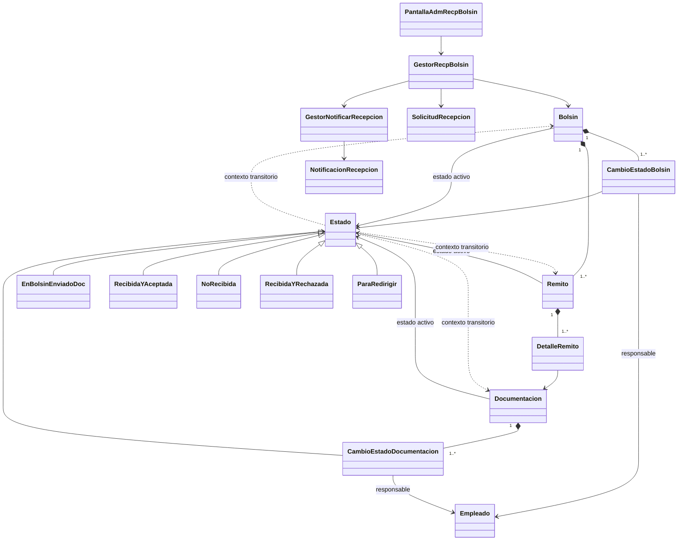
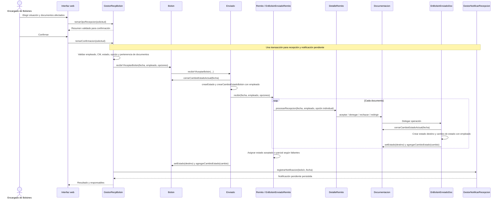

# Adecuación del CU28 a la ERS v1.2 y la Entrega 2

Referencias aportadas: ERS v1.2 (reglas de negocio, página 6; CU28, páginas 11–12), consignas 2026 (Entrega 2, página 4) y diagrama de clases Rediseño v2.1. Este documento registra los cambios que deben trasladarse a los modelos de entrega; no modifica los PDF originales ni reemplaza la presentación formal con carátula.

## Alcance y decisiones

El grupo 8 implementa CU28 y aplica State a Documentación. Se conserva la jerarquía común `Estado` del diagrama, con estados concretos para Bolsín, Remito y Documentación. La integración de V3 (`upstream/main`, commit `da63ebc`) agrega una referencia directa al estado activo y una referencia inversa transitoria desde el estado al contexto. Las entidades delegan las operaciones al estado actual; los estados concretos crean los estados destino y los cambios de estado; el gestor coordina la transacción y valida el contexto de la recepción.

La elección se realiza para el bolsín y se identifican los documentos afectados. Los demás documentos se aceptan. Una recepción registra una de las situaciones enumeradas en el CU28; combinar varias situaciones diferentes en una misma recepción queda fuera de esta interfaz.

| Situación | Documentos afectados | Documentos restantes | Remito |
| --- | --- | --- | --- |
| Contenido completo | Todos recibidos y aceptados | No aplica | Recibido y aceptado |
| Faltantes | No recibidos | Recibidos y aceptados | Parcial si contiene faltantes; aceptado si no los contiene |
| No corresponden al destino | Recibidos y rechazados | Recibidos y aceptados | Recibido y aceptado, con resultado individual en documentos |
| Redirección en CMC | Para redirigir | Recibidos y aceptados | Recibido y aceptado, con resultado individual en documentos |

La ERS especifica que el remito queda parcial cuando el origen devuelve el documento faltante a Registrada o lo da de baja. Se adopta recepción parcial desde el registro del faltante, sin esperar esa gestión posterior, para reflejar de inmediato que el contenido no llegó completo. La ERS no prescribe otro estado del remito ante rechazo o redirección; se mantiene recibido y aceptado y se conserva la incidencia en los documentos. Ambas decisiones deben validarse con el tutor y reflejarse en la máquina de estados.

El bolsín pasa a RecibidoEnCMDestino en las cuatro situaciones. Las acciones posteriores del origen y la distribución interna de la CMC pertenecen a otros casos de uso: no se implementan sus operaciones completas aquí.

## Trazabilidad y persistencia

Los cambios de estado de Bolsín y Documentación incorporan una referencia `Empleado`. Los registros nuevos de recepción guardan obligatoriamente el empleado resuelto desde el contexto de la demo. Los registros iniciales o heredados pueden no tener responsable, y la interfaz lo informa.

Las escrituras del bolsín, documentos, remitos y notificación pendiente se ejecutan en la misma transacción. Una transición inválida revierte la recepción completa. `@Version` protege las entidades frente a actualizaciones sobre una versión anterior; SQLite tiene limitaciones para escrituras simultáneas. No se implementa un sistema de autenticación: se usa la única sesión activa precargada para la defensa.

`ddl-auto=update` conserva el historial al reiniciar. Para bases anteriores, Hibernate agrega las columnas faltantes sin borrar tablas; el arranque inicializa las versiones nulas y reconstruye la referencia directa al estado desde el cambio de estado actual. La columna de estado admite nulos durante esa adaptación; las operaciones de dominio exigen un estado activo. Las referencias inversas se restablecen al cargar y antes de delegar cada operación, para soportar las filas de estados compartidas por la versión anterior sin confundir documentos ni bolsines. Esto es una adaptación para el proyecto académico, no un sistema de migraciones para producción.

## Integración del CU29

`GestorNotificarRecepcion` prepara y persiste una notificación al email de la CM origen con el resultado de los remitos y cada documento. Estado: `PENDIENTE_ENVIO`. No cambia automáticamente documentos faltantes a Registrada o DeBaja: esas decisiones corresponden al origen.

**Falta integrar el transporte de correo para completar el envío exigido por el CU29.** La aplicación no informa que el correo fue enviado. No se configura ni se utiliza un servidor SMTP y las pruebas no envían mensajes reales.

## Cambios para trasladar al diagrama de clases

- Agregar la asociación desde ambos cambios de estado hacia `Empleado` (opcional para historia anterior, obligatoria en las recepciones nuevas).
- Agregar `SolicitudRecepcion(bolsinId: Long, opcion: OpcionRecepcion, documentosAfectados: Set<Long>)` y el enum de opciones.
- Quitar del gestor el estado mutable del flujo: la selección pertenece a cada pestaña y se envía en la solicitud. Cancelar descarta la selección sin escribir en el servidor.
- Las operaciones de recepción de Bolsín y Remito reciben `Map<Long, OpcionRecepcion>` para resolver las decisiones individuales.
- Agregar `esRecibidoYAceptadoParcial(): boolean` a Estado y su redefinición en el estado parcial del remito.
- Incorporar el atributo `estado: Estado` a Bolsín y Documentación, conservando los historiales. Los contextos exponen `setEstado` y `changeState` como en V3.
- Incorporar las referencias inversas transitorias de Estado a sus contextos, sus constructores y la revinculación al cargar desde JPA.
- Los estados concretos crean las instancias destino (`crearEstado`, `crearEstadoRem`, `crearEstadoDoc`) y los cambios de estado con el empleado responsable. Las asociaciones persisten esas instancias por cascada; ya no se consulta un catálogo global para transicionar.
- Agregar `GestorNotificarRecepcion`, `NotificacionRecepcion` y su repositorio como integración pendiente de transporte del CU29.

## Secuencia del escenario rediseñado

## Validación y defensa

`mvn test` ejecuta pruebas con SQLite temporal: recepción completa; faltantes; rechazo; redirección; validación de CMC y CM destino; documentos ajenos; confirmación repetida; selecciones independientes; cancelación sin escritura; rollback de la cascada; búsquedas sin resultados conservación tras reiniciar y migración desde el esquema anterior con estados compartidos.

Para demostrar el patrón: seguir `Documentacion.aceptar` hasta `EnBolsinEnviadoDoc.aceptar` y la creación del historial. En una recepción con incidencias, comparar el documento seleccionado con el restante y mostrar el responsable persistido.
